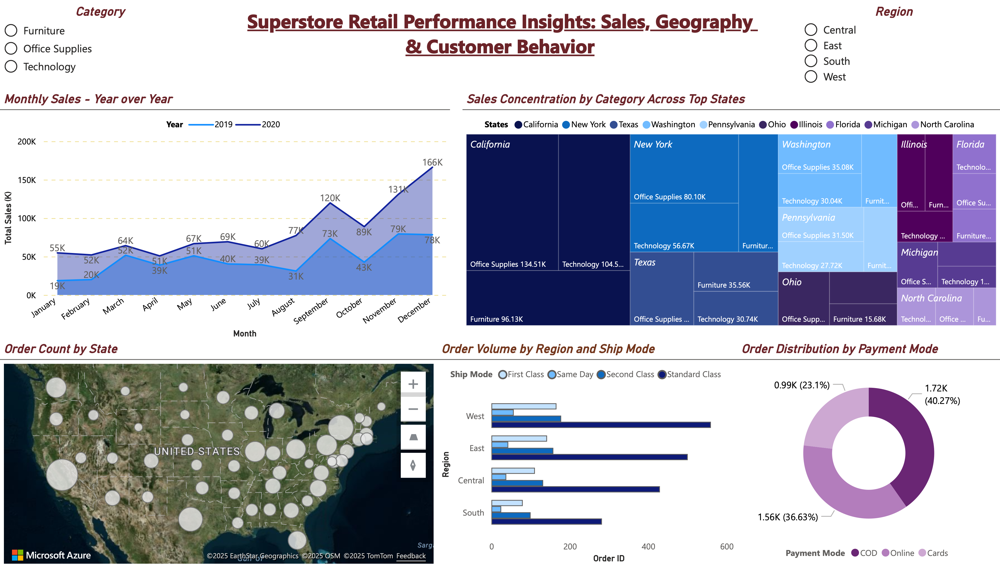
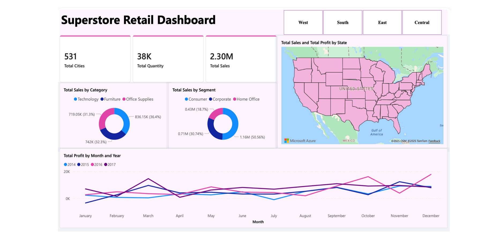
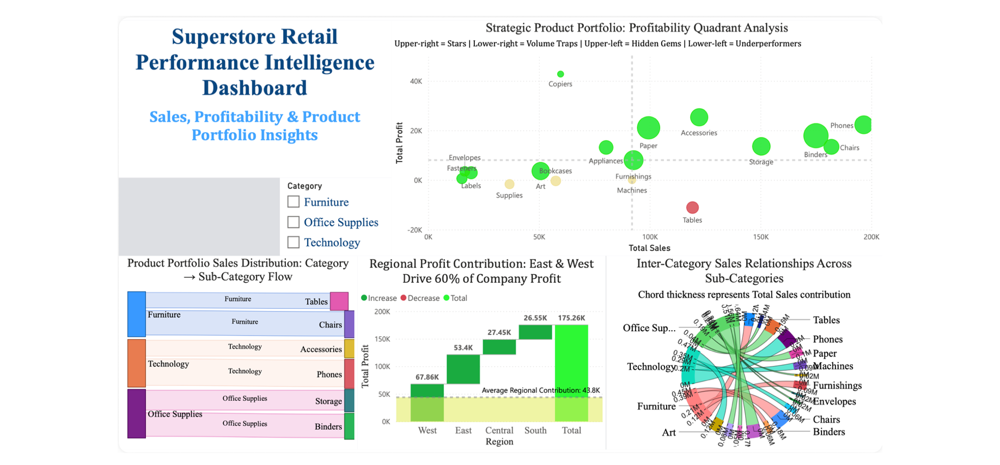

# Superstore Retail Analytics (Power BI)

This was our final project for **IS 525** at the University of Illinois Urbana-Champaign (Fall 2025). We took the Superstore retail sales data and built a set of interactive Power BI dashboards to answer a fairly simple question: *where does this business actually make its money, and where is it losing it?*

High sales don't always mean high profit, and that idea ended up shaping most of the project. A product line can sell a lot and still drag margins down, and a region can look busy on a map while contributing very little to the bottom line. The dashboards are meant to make those gaps easy to spot, even for someone who doesn't work with data every day.

**Team:** Sakshi Katolkar, Srinath Venkatesh, Kanishka Gupta

---

## The dashboards

### 1. Sales, Geography & Customer Behavior



An overview of how sales move through the year, where orders come from, and how customers ship and pay. You can filter everything by category and region using the slicers at the top.

- Monthly sales for 2019 vs 2020
- A treemap of the top 10 states broken down by category
- Order counts by state on a map
- Orders by region and ship mode
- Orders by payment mode (COD, Online, Cards)

### 2. Overall Retail Performance



The "big picture" view: total sales, quantity and number of cities served, plus how revenue splits across categories and customer segments, and how profit trends month by month across four years. This one was built on the original Kaggle Superstore file (2014–2017), so the totals differ from the other two dashboards.

### 3. Product Portfolio & Regional Profitability



The more strategic view, and probably the most interesting one.

- **Profitability quadrant:** every sub-category plotted by sales vs profit and split into Stars, Hidden Gems, Volume Traps and Underperformers
- **Waterfall:** how each region adds up to total company profit, with the regional average marked
- **Sankey:** how sales flow from category down to sub-category
- **Chord diagram:** how sales are spread across sub-categories

---

## What we found

- **Sales grew a lot in 2020.** Monthly sales were higher than 2019 in every single month, and total sales went from roughly $564K to about $1M. Q4 is consistently the strongest stretch, with December 2020 the peak at $166K.
- **Tables are a volume trap.** They brought in about $119K in sales but lost around $11K. Bookcases and Supplies were also slightly in the red.
- **Copiers are the hidden gem.** They made only about $60K in sales but earned nearly $43K in profit, more than any other sub-category.
- **Phones and Chairs are the stars:** high sales and solidly profitable.
- **West and East carry the business.** Together they account for roughly two-thirds of total profit, and Central and South both fall below the regional average.
- **Standard Class is by far the most used shipping mode** in every region.
- **Cash on delivery is still the single most common payment mode** (about 40% of orders), though Online and Cards combined make up the majority.
- **California and New York dominate sales**, and California alone sells more than New York and Texas combined.

---

## What's in this repo

```
├── dashboards/
│   ├── Geographic_Regional_Sales_Dynamics.pbix          # Dashboard 1 (final)
│   └── Superstore_Retail_Performance_Analyzer_draft.pbix # early draft we started from
├── data/
│   ├── raw/SuperStore_Sales_Dataset.csv
│   └── cleaned/Cleaned_SuperStore_Sales_Dataset.(csv|xlsx)
├── reports/
│   ├── IS525_Final_Project_Report.pdf      # full write-up of all three dashboards
│   ├── Project_Proposal.pdf
│   ├── Geographic_Regional_Sales_Dynamics_Dashboard.pdf
│   └── All_Dashboards.pdf                  # each visual from Dashboard 1 on its own page
└── images/                                 # screenshots used above
```

If you just want the full story, start with **`reports/IS525_Final_Project_Report.pdf`**. It walks through each dashboard, who it's for, and what we learned while building it.

> Only the `.pbix` files for Dashboard 1 and the early draft are in this repo. Dashboards 2 and 3 were built separately by teammates, so they appear here as screenshots and in the report.

---

## The data

The main dataset has **5,901 order lines** (about 3,000 orders) from **2019 and 2020** across 49 US states. Each row has the order and ship dates, ship mode, customer segment, location, product category and sub-category, sales, quantity, profit, returns and payment mode.

The original Kaggle Superstore dataset is here: https://www.kaggle.com/datasets/vivek468/superstore-dataset-final/data

**Cleaning (done in Excel and Power Query):**
- Converted the order and ship dates from day/month to a consistent month/day/year format so Power BI reads them correctly
- Fixed a broken header in the first column
- Added a *Delivery Days* measure in Power BI (Ship Date − Order Date)

---

## How it was built

- **Power BI Desktop** for modelling and visuals
- **Power Query** for cleaning and shaping the data
- **DAX** measures for total sales, profit, profit margin, year-over-year sales, average delivery days, return rate and regional contribution
- Custom visuals for the Sankey and chord diagrams

Our first versions were pretty crowded. After feedback from classmates and a few friends outside the course, we cut a lot of visuals, moved the map from city level to state level, switched to a lighter theme, and spent more time on titles and labels so each chart explains itself.

---

## Opening the files

You'll need [Power BI Desktop](https://www.microsoft.com/power-platform/products/power-bi/desktop) (free, Windows only) to open the `.pbix` files. If Power BI asks you to locate the data source, point it to the CSV in `data/cleaned/`.

If you're on a Mac or just want a quick look, the screenshots above and the PDFs in `reports/` cover everything.
